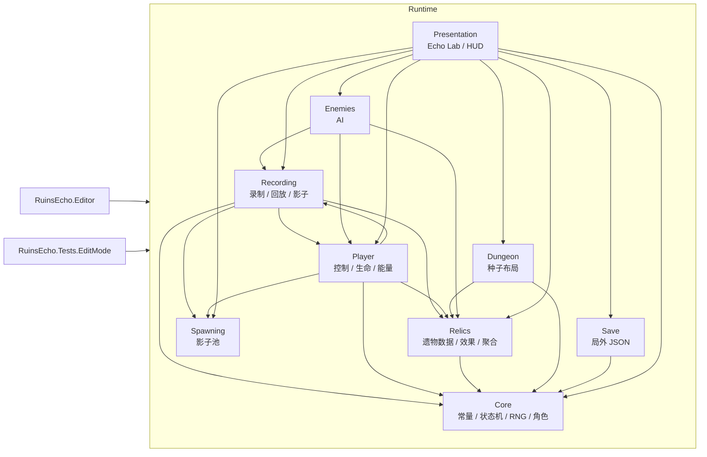
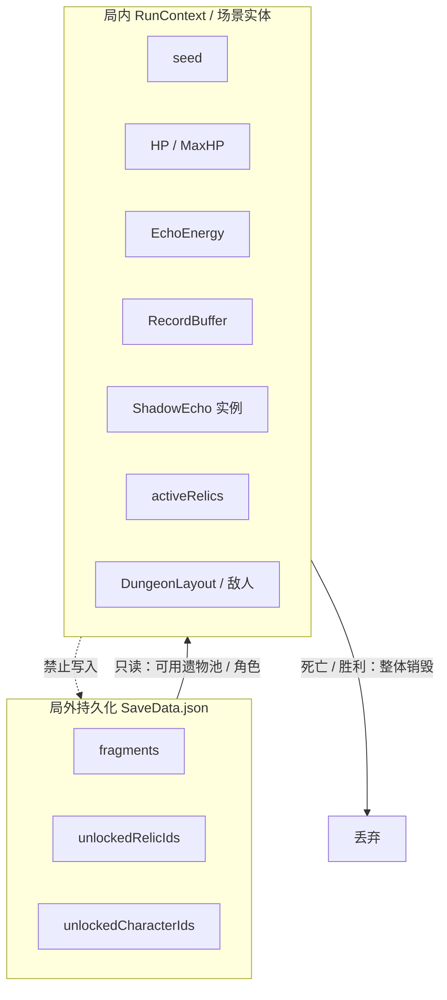
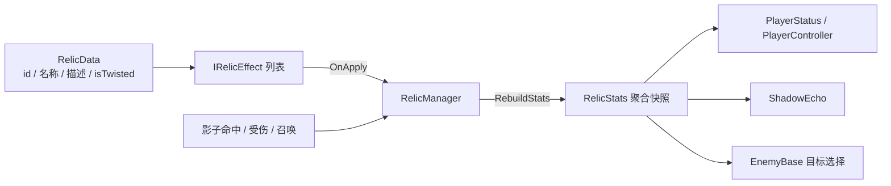

# 架构设计

- 版本：v0.1（M0 / M1 技术切片）
- 对应规格：[遗迹回响：影子共生 单机 MVP 开发规格文档](spec/遗迹回响_影子共生_单机MVP开发规格文档.md)

---

## 1. 目标与边界

本仓库先把三类高风险问题做成可验证的骨架：

1. **动作录制 / 影子回放**：时间轴、重复时间戳、变速、循环、反向、对象池。
2. **遗物改写行为**：接口 + 聚合属性，避免 `if (relic == ...)` 扩散。
3. **确定性**：种子生成 5 层地牢数据，同种子完全可复现。

表现层（Echo Lab）刻意保持廉价：运行时生成纯色 Sprite、IMGUI HUD、无 Prefab / Scene 依赖。这样在没有任何美术资源的情况下，也能验证核心循环。正式场景、UGUI、Boss、房间流程按[路线图](roadmap.md)替换。

---

## 2. 程序集与依赖方向



约束：

- `Core` 不依赖任何业务模块。
- `Recording` 是核心模块，可以被未来联机回放复用。
- `Presentation` 是唯一允许“知道所有模块”的组装层。
- 不引入第三方 DI 框架；Echo Lab 用构造函数 / `Initialize` 手动注入。

---

## 3. 一局游戏的数据边界



- 进入一局时，从 `SaveData` 读取解锁池；`RunContext` 持有种子、角色、地牢布局等局内数据。
- 死亡 / 胜利时只把“本局获得的残片”结算到局外，然后丢弃 `RunContext`、遗物列表、缓存、影子与敌人。
- 代码层面的保证：`SaveData` 没有引用任何 `RecordFrame` / `RelicManager` / `PlayerStatus`。

---

## 4. 录制与回放

### 4.1 数据结构

```text
RecordFrame
├─ UnscaledTimestamp : float   // Time.unscaledTime
├─ WorldPosition     : Vector2
├─ Rotation          : float   // Z 轴角度
├─ TriggerAttack     : bool
└─ TriggerDodge      : bool
```

`RecordBuffer` 维护 3 秒滑动窗口（角色可 +0.5s）：

- 每帧 `Append`；乱序时间戳直接拒绝。
- `newest - oldest > MaxDuration` 时从头部删除，至少保留 1 帧。
- 容量约 400 帧（120 FPS × 3.5s），`List.RemoveAt(0)` 的成本在 MVP 可接受；正式版可换环形缓冲。

### 4.2 PlayerRecorder

`LateUpdate` 记录，保证拿到移动后的最终位置，并与 `PlayerController.Update` 解耦。

```text
PlayerController.Update
  ├─ 读取输入 / 移动 / 瞄准
  ├─ 设置 AttackTriggeredThisFrame / DodgeTriggeredThisFrame
  └─ 处理 Q / R
PlayerRecorder.LateUpdate
  └─ Append(RecordFrame(Time.unscaledTime, transform.position, AimAngle, flags))
```

- 休憩房 / 奖励界面通过 `SetFrozen(true)` 暂停追加；离开后恢复。
- `R` → `ClearBuffer()`。
- `Q` → `GetBufferCopy()`，复制后交给影子，避免影子与玩家共享可变 List。

### 4.3 回放游标

`PlaybackCursor` 是纯 C# 类，把绝对时间戳转换成相对时间轴：

```text
relativeTime[i] = frame[i].UnscaledTimestamp - frame[0].UnscaledTimestamp
```

每帧调用：

```csharp
cursor.Speed = bossDistortion ? 0.5f : 1f;
cursor.AdvanceBy(Time.unscaledDeltaTime, dueFrames);
foreach (frame in dueFrames) Apply(frame);
```

语义：

| 能力 | 实现 |
| --- | --- |
| 变速 | `AdvanceBy(delta * Speed)`；Boss 扭曲力场设 0.5 |
| 循环 | 遗物【残影存续】设 `Loop=true`；到尾部后 `Mathf.Repeat` 回绕并重置索引 |
| 反向 | `Reverse=true` 时从尾部向头部消费；`SetDirection` 支持运行中反转 |
| 重复时间戳 | 用 `<= playhead`（正向）/ `>= playhead`（反向），同一帧时间的所有帧都会执行 |
| 空缓存 | `IsFinished=true`，影子立即回池 |
| 单帧录制 | 执行一次后结束，避免循环高速重放 |

**关键不变量**：影子位移只写 `Transform`，从不创建 / 驱动 `Rigidbody2D`。

### 4.4 影子生命周期

```mermaid
sequenceDiagram
    participant P as PlayerController
    participant R as PlayerRecorder
    participant Pool as ShadowPool
    participant S as ShadowEcho
    participant E as EnemyBase

    P->>R: HasValidBuffer()
    P->>P: Energy.TryConsume(SummonCost)
    P->>R: GetBufferCopy()
    loop 每个影子（双生回响 = 2）
        P->>Pool: Get()
        Pool-->>P: ShadowEcho
        P->>S: Setup(frames, damage, hp, relics, owner, pool)
        P->>S: StartPlayback()
        S->>S: cursor.Reset(); AdvanceBy(0)
        loop 每帧
            S->>S: cursor.AdvanceBy(unscaledDelta)
            S->>S: transform.position = frame.position
            alt TriggerAttack
                S->>E: TakeDamage()
                S->>P: CombatEvents.ShadowHitEnemy
            end
        end
    end
    S->>Pool: ReturnToPool()（播完 / HP 归零 / 主动清理）
```

- 影子 HP 独立；敌人可攻击影子；蚀影怪击杀影子会扣 15 能量。
- 影子死亡立即终止回放并回池，不执行剩余帧。
- 自然播完默认回池；【残影存续】改为循环。
- `ShadowPool` 上限 10；`Factory` 由 Bootstrap 注入，避免池依赖表现层。

---

## 5. 遗物管线



- `RelicManager.AddRelic`：容量检查 + 去重 → 加入列表 → `RebuildStats()` → 事件。
- `RebuildStats` 每次从零重算，天然幂等；`OnRemove` 不需要手工回滚字段。
- 效果只写 `RelicStats`，战斗代码只读快照。
- MVP 9 件遗物（5 增益 + 4 扭曲）全部通过效果类实现：
  - 循环、双生、替影承伤、回响传导、掠影打击
  - 共生反噬、能量狂潮、意志侵蚀、动作乱流

新增遗物的步骤：

1. 在 `RelicStats` 增加字段（如果现有字段不够）。
2. 新建 `RelicEffectBase` 子类，在 `OnApply` 写修正。
3. 在 `RelicCatalog` 注册 ID / 文案 / 效果。
4. 在对应系统读取 `Stats`，不要写 `if (relicId == ...)`。

---

## 6. 确定性随机与地牢

`DeterministicRandom` 使用 SplitMix64：

- 固定算法，不依赖 Unity 版本 / 平台。
- 提供 `NextUInt / Range(int) / Range(float) / Chance / Pick / Shuffle`。
- `Shuffle` 为 Fisher-Yates，用于遗物三选一。

`DungeonGenerator.Generate(seed, availableRelicIds)`：

1. 对可用遗物 ID 做 `Distinct + Ordinal Sort`，消除输入顺序影响。
2. 每层生成：战斗房 → 休憩分支 / 事件分支 → Boss 房。
3. 战斗房敌人数量、种类、位置、三选一奖励均由 RNG 决定。
4. Boss HP / 伤害随层数缩放；第 5 层标记 `IsFinalBoss`。
5. 输出纯数据 `DungeonLayout`，不依赖场景。

测试保证：

- 同 seed → 敌人种类 / 位置 / 奖励完全一致。
- 不同 seed → 布局不同。
- 遗物池输入顺序不同 → 奖励一致。

---

## 7. 战斗与伤害

```text
IDamageable
├─ PlayerStatus
├─ ShadowEcho
└─ EnemyBase

DamageInfo
├─ Amount
├─ Source : GameObject
├─ IsCritical
├─ SourceType : Player / Shadow / Enemy / Environment / Redirect
└─ HitPoint
```

- 玩家普攻：`Physics2D.OverlapCircleNonAlloc`，命中后按暴击 / 标记倍率结算。
- 影子普攻：同一套 Overlap 查询；伤害继承玩家攻击力并叠加影子倍率。
- 闪避：玩家 `IsInvulnerable` 期间忽略伤害；影子回放 `TriggerDodge` 帧获得短暂无敌。
- 标记：影子暴击 +【掠影打击】给敌人挂 3 秒标记，玩家对被标记目标 +30%。
- 替影承伤：玩家受伤时把 25% 转移给最近的存活影子。
- 共生反噬：影子攻击范围覆盖本体时，对本体造成伤害。
- 敌人 AI：近战追击；蚀影怪 / 替影承伤遗物下优先影子；无目标时原地不动。

---

## 8. 表现层（Echo Lab）

```text
EchoLabBootstrap (RuntimeInitializeOnLoadMethod / 场景内组件)
├─ GreyboxFactory：相机、地面、网格、玩家、敌人、影子
├─ RelicManager / ShadowPool
├─ PlayerStatus / PlayerRecorder / PlayerController
├─ EchoLabHud (IMGUI)
└─ RunStateMachine：InCombat ↔ RoomReward → 下一波
```

- 不依赖任何 Prefab / Scene / 图片资源；打开工程按 Play 即可。
- `Tools → Ruins Echo → Create Main Scene` 生成一个只含 Bootstrap 的正式场景，便于 Build。
- HUD 展示 HP、能量、缓存时长 / 帧数、影子数量、遗物列表、三选一、死亡结算。
- `EchoLabBootstrap` 不是最终 GameFlow；它只验证核心循环，正式 5 层流程在 M3。

---

## 9. 与规格的差异 / 决策

| 规格 | 当前实现 | 原因 / 后续 |
| --- | --- | --- |
| `Random.State` | 自研 SplitMix64 | 跨 Unity 版本稳定；ADR-0001 |
| ScriptableObject 资产 | 运行时 `RelicCatalog` / `CharacterCatalog` 创建 SO | 无美术 / 无 .asset 依赖，便于先跑通；M4 可替换为资产 |
| UGUI | IMGUI 调试 HUD | 技术切片优先可观察；M5 替换 |
| Prefab / Tilemap 房间 | 运行时灰盒 | 先验证核心循环；M3 替换 |
| Trigger2D 伤害检测 | `OverlapCircle` 查询 | 不引入 Rigidbody；仍是 2D 物理查询，满足“碰撞体只做伤害检测” |
| 完整 5 层流程 | 数据层已生成，表现层只做波次循环 | M3 接入房间 / 传送门 / 分支 |
| Boss 扭曲力场 | `PlaybackSpeedMultiplier` / `SetPlaybackDirection` 接口已留 | M2 接入 Boss 光环 |
| 暴击 | 规格未给数值，补 15% / 1.5x | 为【掠影打击】提供最小规则；可配置 |

---

## 10. 扩展点

- **联机**：`RecordFrame` / `PlaybackCursor` 不依赖玩家输入，可直接序列化传输；种子同步地牢。
- **更多遗物**：只新增效果类 + 注册，不动战斗代码。
- **Boss**：读取 `RoomNode.BossId / BossMaxHP / BossDamage`；调用 `ShadowEcho.PlaybackSpeedMultiplier` 与 `SetPlaybackDirection`。
- **房间表现**：用 `DungeonLayout` 驱动 Tilemap / Prefab 实例化；`RoomNode.RoomSeed` 可用于房间内二次随机。
- **对象池**：`ShadowPool` 已抽取 `Factory`；敌人 / 投射物可复用同一模式。
